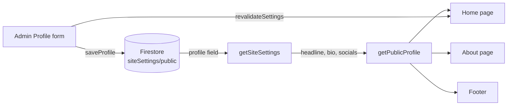

<div align="center">

# Zubair Developer

**Premium portfolio and client-acquisition website for a Full Stack, SaaS and AI Chatbot developer.**

Show real work. Explain the process. Turn visitors into project inquiries.

<br />


[Features](#-features) · [How it works](#-how-it-works) · [Getting started](#-getting-started) · [Structure](#-project-structure) · [Troubleshooting](#-troubleshooting) · [Roadmap](#-roadmap)

</div>

<!--
Add a screenshot or a short demo GIF here once the redesign is deployed:

-->

---

## ✨ Overview

Zubair Developer is a conversion-focused portfolio built like a product. A visitor can understand what is built, explore relevant work, compare services and pricing, and start a project inquiry in a few clicks.

Everything a client reads comes from the admin panel or real configuration. There are no invented testimonials, client logos, statistics or availability badges.

## 🚀 Features

### Public website

| Area | What it does |
| --- | --- |
| **Hero** | Typewriter role headline ("I build…") that cycles through services, with an accessible, layout-stable caret. |
| **Developer workspace** | Interactive frontend / backend / AI chatbot preview. Auto-cycles, pauses on hover or focus, and has keyboard-accessible tabs. Illustrative only: no real requests. |
| **Technology marquee** | Seamless CSS-only loop of technologies. Uses admin-managed skills and falls back to a default list. |
| **Trust strip** | Written proposal, direct communication, staged delivery and clean handover. |
| **Project finder** | Visitors pick what they need and see the best-fit service with a quote link. |
| **Capabilities, services, pricing** | Clear starting prices, with the final scope agreed in writing. |
| **Projects and experience** | Case studies and roles driven by admin content. |
| **Process, FAQ, final CTA** | Removes uncertainty and gives a clear next step. |
| **Profile everywhere** | Headline, bio and social links appear on the home page, About page and footer. |
| **Mobile call-to-action bar** | Request a quote plus WhatsApp or Email, always within reach. |
| **Sticky section navigation** | Jump to any section while scrolling. |

### Admin panel

| Area | What it does |
| --- | --- |
| **Secure sign-in** | Firebase authentication with server-side session cookies. |
| **Role-based permissions** | Pages and actions are gated by permission. |
| **Profile editor** | Headline, bio, GitHub, LinkedIn, Instagram and Facebook, with a live sync check against the public site. |
| **Announcements** | Schedule a site-wide announcement with start and end dates. |
| **Content management** | Skills, experience, services, projects and more. |
| **Command palette** | Fast keyboard navigation inside the admin area. |
| **Activity log** | Every settings change is recorded with the admin who made it. |

### Quality built in

- 🧩 Server Components by default, small Client Components only where needed
- ♿ Semantic HTML, visible focus states, screen-reader-friendly animated text
- 🎞️ `prefers-reduced-motion` respected for every animation
- 🔎 Metadata, canonical URLs and `ProfessionalService` structured data (JSON-LD)
- 🔒 Admin credentials stay on the server; public pages only receive public fields

## 🧠 How it works

The admin Profile form saves to one Firestore document, and the public site reads only the public fields back.



Pages use `revalidate = 60`, so changes can take up to a minute to appear unless `revalidateSettings()` refreshes them sooner.

## 🛠️ Tech stack

| Layer | Tools |
| --- | --- |
| Framework | Next.js (App Router), JavaScript with JSX only |
| Styling | Tailwind CSS v4, shadcn/ui, Lucide React |
| Motion | Framer Motion, CSS transforms |
| Data and auth | Firebase (Firestore, Authentication, Admin SDK) |
| Forms | React Hook Form, Zod |

## ⚡ Getting started

**Requirements:** a Node.js version supported by your Next.js release, and a Firebase project.

```bash
# install dependencies
npm install

# start the development server
npm run dev
```

Open <http://localhost:3000>.

```bash
npm run build   # production build
npm run start   # run the production build
```

### Environment variables

Firebase client configuration and Firebase Admin credentials are read from environment variables. Put them in `.env.local` and never commit that file. Admin credentials must never reach client components.

## 📁 Project structure

```text
app/
├─ (website)/          Public pages
└─ admin/              Admin panel
components/
├─ about/              Hero workspace, typewriter, marquee, project finder
├─ home/               Homepage sections
├─ admin/              Admin UI
├─ shared/             Section, Reveal, SectionHeading and shared pieces
└─ ui/                 shadcn/ui components
lib/
├─ firebase/           Admin and client Firebase helpers
└─ profile/            Public profile normalization and social links
services/              Data access: settings, content, services, activity
config/                Site configuration and navigation
```

## 🎨 Conventions

- Pages stay Server Components. Client Components are small and focused.
- JavaScript and JSX only. No TypeScript.
- Forms use shadcn/ui `Field` components with React Hook Form and Zod, inside `Card` containers.
- Never use `asChild` on shadcn/ui components.
- Every animation respects `prefers-reduced-motion`.
- Show real data or a clear empty state. Never fake proof.

## 🩺 Troubleshooting

<details>
<summary><strong>Social links, headline or bio do not appear on the public site</strong></summary>

1. Open the admin Profile page and read the **Public site sync check**. It tells you whether the public site receives the saved profile.
2. Confirm `getSiteSettings()` reads `siteSettings/public` and returns a `profile` object.
3. Wait up to a minute (ISR), or make sure `revalidateSettings()` revalidates the home page, About page and layout.
4. Use `SocialRow` from `lib/profile/public-profile.js` with the normalized socials. Passing them to a component that expects another shape renders nothing.

</details>

<details>
<summary><strong>Build error: export does not exist in module</strong></summary>

Check the exact export name in the target file. For example, the Firebase helper exports `getAdminDb` (a function), not an `adminDb` object.

</details>

<details>
<summary><strong>Animated headline causes layout shift</strong></summary>

Keep the reserved height on the paragraph that wraps `TypedRole`. It reserves two lines on small screens so longer phrases do not push content down.

</details>

## 🗺️ Roadmap

- [x] Profile saved in Firestore and shown on home, About and footer
- [x] Hero with typewriter headline, interactive workspace and technology marquee
- [x] Mobile call-to-action bar and sticky section navigation
- [ ] Redesign navigation with an `Alt+K` command menu
- [ ] Redesigned services, featured projects, process and pricing
- [ ] Prefill the inquiry form from the project finder (`/hire-me?service=...`)
- [ ] Admin-managed testimonials and case studies
- [ ] WhatsApp field in the admin Profile form
- [ ] Back-to-top button and reading progress indicator

## 🤝 Contact

Have a project in mind? Use the **Start a Project** button on the website, or reach out through the email and social links shown in the footer.

## 📄 License

All rights reserved. Contact the owner before reusing any part of this project.