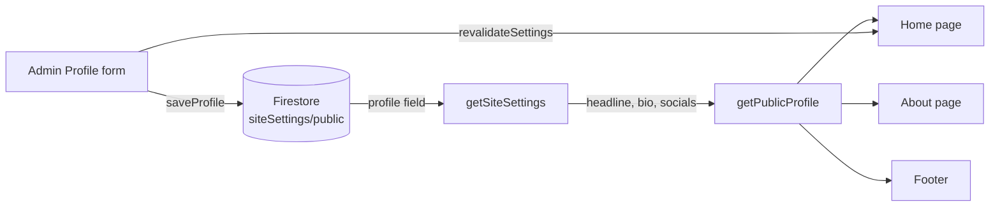

<div align="center">

# Zubair Developer

**Premium portfolio and client-acquisition website for a Full Stack, SaaS and AI Chatbot developer.**

Show real work. Explain the process. Turn visitors into project inquiries.

<br />


[Features](#-features) · [How it works](#-how-it-works) · [Getting started](#-getting-started) · [Structure](#-project-structure) · [Troubleshooting](#-troubleshooting) · [Roadmap](#-roadmap)

</div>

<!--
Add a screenshot or a short demo GIF here once the redesign is deployed:

-->

---

## ✨ Overview

Zubair Developer is a premium portfolio and client-conversion platform for a Full Stack Developer, SaaS builder, and AI automation specialist. It is designed to show technical ability, simplify the decision-making process, and turn website visitors into real project inquiries.

This project presents a polished personal brand for someone who builds production-ready web apps, automates business workflows, and develops AI-powered chatbot systems. The site is built to feel premium, trustworthy, and conversion-focused without relying on fake claims or filler content.

The experience is shaped around a real portfolio brand: clear positioning, project-focused proof, strong service clarity, direct contact paths, and a modern design that reflects technical depth and execution quality.

## 🚀 Features

### Public website

| Area | What it does |
| --- | --- |
| **Premium hero section** | Highlights services such as Full Stack development, SaaS products, AI automation, and chatbot systems in a strong conversion-first layout. |
| **Developer workspace preview** | Shows frontend, backend, and AI workflow capabilities through an elegant product-style interface. |
| **Technology stack showcase** | Displays relevant tools, frameworks, and platform skills in a polished rotating marquee. |
| **Services and pricing clarity** | Helps users understand available offerings, engagement types, and what a project can include. |
| **Project finder / inquiry flow** | Lets visitors quickly identify what they need and reach the ideal contact path. |
| **Full-stack credibility** | Positions the portfolio around modern web architecture, databases, APIs, automation, and production-ready builds. |
| **AI and chatbot automation focus** | Highlights chatbot development, workflow automation, and AI integration as part of the service mix. |
| **Process and trust content** | Explains how work is handled, what the client can expect, and how delivery flows. |
| **Portfolio storytelling** | Presents work, experience, and expertise in a way that feels professional and client-friendly. |
| **Mobile CTA bar** | Keeps WhatsApp or email contact accessible from mobile screens. |
| **Sticky navigation and smooth scrolling** | Improves usability and keeps the site feeling premium on long-form pages. |

### Business and portfolio positioning

| Area | What it does |
| --- | --- |
| **Client acquisition design** | Built to help a developer convert interested visitors into business conversations. |
| **Real brand-first content** | Focuses on the actual identity of Zubair Developer and the kinds of work they deliver. |
| **Full Stack confidence** | Shows capability across web apps, product UI, backend logic, integrations, and technical execution. |
| **AI automation value** | Positions the portfolio around chatbot systems, smart internal tools, and automated business processes. |
| **Professional credibility** | Uses structured data, polished UI, and clear service messaging instead of generic placeholders. |

### Admin panel

| Area | What it does |
| --- | --- |
| **Secure sign-in** | Firebase authentication with server-side session cookies. |
| **Role-based permissions** | Pages and actions are gated by permission. |
| **Profile editor** | Controls headline, bio, social links, and public brand details that sync to the live site. |
| **Announcements** | Lets the owner publish time-based site-wide alerts. |
| **Content management** | Handles skills, projects, services, experience, and portfolio content. |
| **Command palette** | Speeds up admin workflow with keyboard navigation. |
| **Activity log** | Records settings changes and admin actions for transparency. |

### Quality built in

- 🧩 Server Components by default, with small Client Components only where needed
- ♿ Semantic HTML, visible focus states, and accessible interaction patterns
- 🎞️ `prefers-reduced-motion` respected across animations and transitions
- 🔎 Structured metadata, canonical URLs, and professional JSON-LD data
- 🔒 Sensitive credentials remain server-side; only public profile data is exposed to the frontend
- 🚀 Designed for a premium portfolio feel that fits a modern Full Stack + AI specialist brand

## 🧠 How it works

The admin Profile form saves to one Firestore document, and the public site reads only the public fields back.



Pages use `revalidate = 60`, so changes can take up to a minute to appear unless `revalidateSettings()` refreshes them sooner.

## 🛠️ Tech stack

| Layer | Tools |
| --- | --- |
| Framework | Next.js (App Router), JavaScript with JSX only |
| Styling | Tailwind CSS v4, shadcn/ui, Lucide React |
| Motion | Framer Motion, CSS transforms |
| Data and auth | Firebase (Firestore, Authentication, Admin SDK) |
| Forms | React Hook Form, Zod |

## ⚡ Getting started

**Requirements:** a Node.js version supported by your Next.js release, and a Firebase project.

```bash
# install dependencies
npm install

# start the development server
npm run dev
```

Open <http://localhost:3000>.

```bash
npm run build   # production build
npm run start   # run the production build
```

### Environment variables

Firebase client configuration and Firebase Admin credentials are read from environment variables. Put them in `.env.local` and never commit that file. Admin credentials must never reach client components.

## 📁 Project structure

```text
app/
├─ (website)/          Public pages
└─ admin/              Admin panel
components/
├─ about/              Hero workspace, typewriter, marquee, project finder
├─ home/               Homepage sections
├─ admin/              Admin UI
├─ shared/             Section, Reveal, SectionHeading and shared pieces
└─ ui/                 shadcn/ui components
lib/
├─ firebase/           Admin and client Firebase helpers
└─ profile/            Public profile normalization and social links
services/              Data access: settings, content, services, activity
config/                Site configuration and navigation
```

## 🎨 Conventions

- Pages stay Server Components. Client Components are small and focused.
- JavaScript and JSX only. No TypeScript.
- Forms use shadcn/ui `Field` components with React Hook Form and Zod, inside `Card` containers.
- Never use `asChild` on shadcn/ui components.
- Every animation respects `prefers-reduced-motion`.
- Show real data or a clear empty state. Never fake proof.

## 🩺 Troubleshooting

<details>
<summary><strong>Social links, headline or bio do not appear on the public site</strong></summary>

1. Open the admin Profile page and read the **Public site sync check**. It tells you whether the public site receives the saved profile.
2. Confirm `getSiteSettings()` reads `siteSettings/public` and returns a `profile` object.
3. Wait up to a minute (ISR), or make sure `revalidateSettings()` revalidates the home page, About page and layout.
4. Use `SocialRow` from `lib/profile/public-profile.js` with the normalized socials. Passing them to a component that expects another shape renders nothing.

</details>

<details>
<summary><strong>Build error: export does not exist in module</strong></summary>

Check the exact export name in the target file. For example, the Firebase helper exports `getAdminDb` (a function), not an `adminDb` object.

</details>

<details>
<summary><strong>Animated headline causes layout shift</strong></summary>

Keep the reserved height on the paragraph that wraps `TypedRole`. It reserves two lines on small screens so longer phrases do not push content down.

</details>

## 🗺️ Roadmap

- [x] Profile saved in Firestore and shown on home, About and footer
- [x] Hero with typewriter headline, interactive workspace and technology marquee
- [x] Mobile call-to-action bar and sticky section navigation
- [ ] Redesign navigation with an `Alt+K` command menu
- [ ] Redesigned services, featured projects, process and pricing
- [ ] Prefill the inquiry form from the project finder (`/hire-me?service=...`)
- [ ] Admin-managed testimonials and case studies
- [ ] WhatsApp field in the admin Profile form
- [ ] Back-to-top button and reading progress indicator

## 🤝 Contact

Have a project in mind? Use the **Start a Project** button on the website, or reach out through the email and social links shown in the footer.

## 📄 License

All rights reserved. Contact the owner before reusing any part of this project.